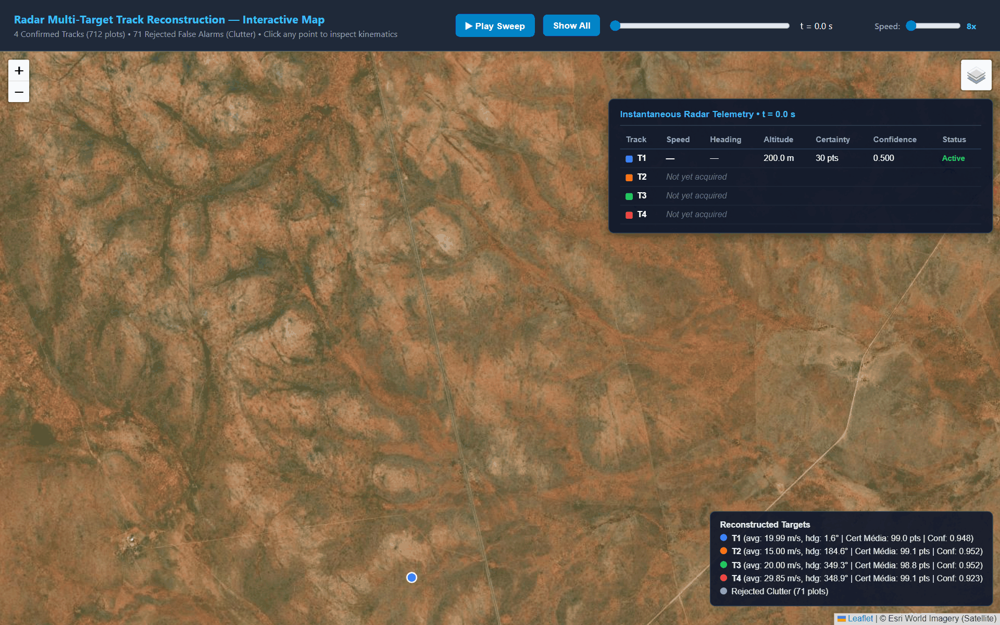
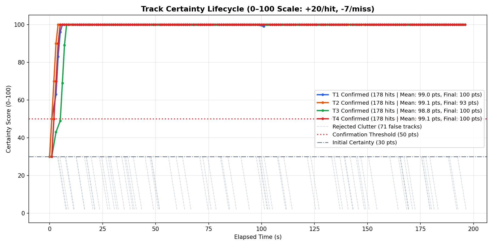
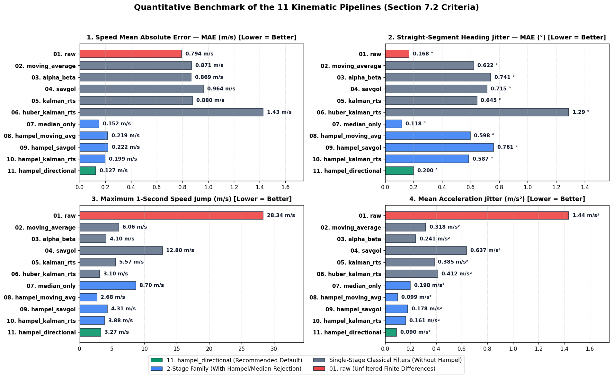
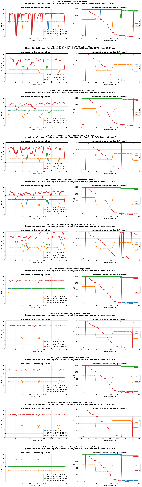
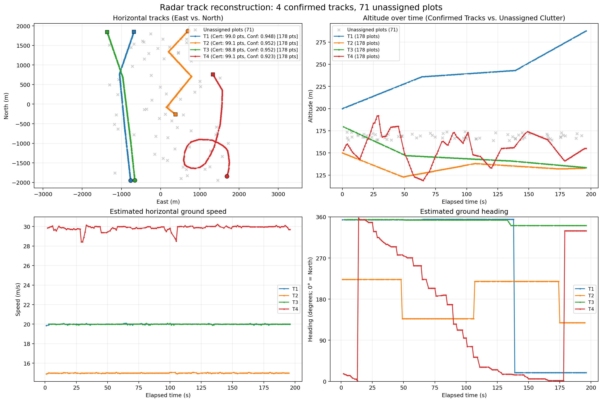
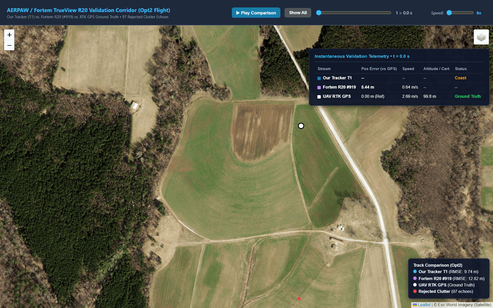
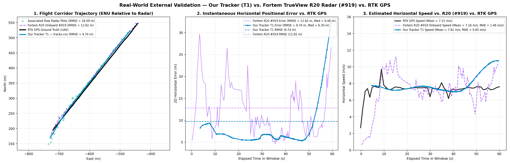

# Radar Plot Track Reconstruction

## Architecture & Project Structure

This project is a proof of concept (PoC) for multi-target radar track reconstruction from 3D radar plots. It is structured as a modular Python package ([`radar_tracker/`](./radar_tracker/)) using standard scientific libraries (`pymap3d`, `filterpy`, `scipy`, `pandas`, `numpy`), an externalized `.properties` configuration file ([`tracker.properties`](./tracker.properties)), and an automated test suite:

```text
algorithm-engineer-task/
├── radar_tracker/                           # Tracking engine
│   ├── track.py                             # Kalman state, gating & lifecycle
│   ├── tracker.py                           # Global association & track export
│   └── kinematics/                          # Speed & heading estimation
├── tests/                                   # Unit & integration tests
├── validations/                             # Fortem R20 / RTK GPS validation
│   ├── scripts/                             # Conversion, scoring & comparison maps
│   ├── data/                                # Radar plots & ground truth
│   └── outputs/                             # Metrics, figures & interactive maps
├── diagnostics/                             # Charts & per-track exports
├── docs/                                    # Animated README previews
├── scripts/export_map_gif.py                # HTML-to-GIF exporter
├── tracker.properties                       # Default configuration
├── tracker.ps1 / tracker.sh / tracker.bat   # CLI entry points
├── radar_track_reconstruction.ipynb         # Step-by-step walkthrough
├── plots.json                               # Input radar detections
├── tracks.json / tracks.csv                 # Reconstructed tracks
└── tracks_interactive_map.html              # Interactive playback
```

<details>
<summary>Expand the detailed file tree</summary>

```text
algorithm-engineer-task/
├── radar_tracker/
│   ├── __init__.py
│   ├── __main__.py
│   ├── cli.py
│   ├── config.py
│   ├── preprocess.py
│   ├── track.py
│   ├── tracker.py
│   ├── visualize_tracks.py
│   └── kinematics/
│       ├── __init__.py
│       ├── kinematics_base.py
│       ├── estimator.py
│       ├── hampel.py
│       ├── directional.py
│       ├── pipeline_evaluator.py
│       ├── moving_average.py
│       ├── alpha_beta.py
│       ├── savgol.py
│       └── kalman_rts.py
├── tests/
│   ├── __init__.py
│   ├── test_config.py
│   ├── test_preprocess.py
│   ├── test_kinematics.py
│   ├── test_track_kalman.py
│   ├── test_tracker_synthetic.py
│   ├── test_validation_utils.py
│   └── test_integration.py
├── diagnostics/
│   ├── all_11_pipelines_speed_and_heading.png
│   ├── pipeline_metrics_benchmark.png
│   ├── certainty_lifecycle.png
│   ├── interactive_radar_map.html
│   └── tracks/
├── validations/
│   ├── README.md
│   ├── fortem_r20.properties
│   ├── validate.ps1 / validate.sh
│   ├── validate_external_datasets.ipynb
│   ├── scripts/
│   │   ├── convert_fortem.py
│   │   ├── evaluate_fortem.py
│   │   ├── geo_metrics.py
│   │   ├── plot_corridor.py
│   │   └── render_comparison_html.py
│   ├── data/
│   │   └── aerpaw_opt2_subset/
│   └── outputs/
│       ├── comparison.html
│       ├── fortem_gps_comparison_corridor.png
│       ├── gps_comparison_corridor.png
│       ├── metrics.json
│       └── tracks/
├── docs/
│   ├── tracking-demo.gif
│   ├── tracking-demo.json
│   ├── validation-comparison.gif
│   └── validation-comparison.json
├── scripts/
│   └── export_map_gif.py
├── tracker.properties
├── tracker.sh
├── tracker.ps1
├── tracker.bat
├── radar_track_reconstruction.ipynb
├── requirements.txt
├── tracks.json
├── tracks.csv
├── tracks_visualization.png
├── tracks_certainty_lifecycle.png
└── tracks_interactive_map.html
```

</details>

### Quick Start

```bash
# 1. Run full pipeline with default configuration (Linux / macOS / Git Bash)
./tracker.sh plots.json tracks.json

# 1b. Run full pipeline with default configuration (Windows PowerShell or CMD)
.\tracker.ps1 plots.json tracks.json
.\tracker.bat plots.json tracks.json

# 2. Run external validation on Real Fortem R20 Radar (converts data -> calls tracker -> generates comparison.html)
# PowerShell:
.\validations\validate.ps1

# Bash:
./validations/validate.sh

# 3. Run automated test suite (24 tests)
python -m unittest discover -s tests -v
```

### Interactive HTML Visualizations & Playback Maps

All interactive maps include a dynamic playback speed slider (`1x` to `10x`, where `1x = 1 update/second`) and a live **Instantaneous Telemetry HUD**. These visualizations can be opened directly in any web browser or viewed embedded via `IPython.display.IFrame` inside the Jupyter Notebook ([`radar_track_reconstruction.ipynb`](./radar_track_reconstruction.ipynb)):
- **Primary Deliverable Radar Player:** [`tracks_interactive_map.html`](./tracks_interactive_map.html) — Full synthetic benchmark reconstruction (`T1`–`T4` and clutter rejection) with live speed, heading, altitude, certainty, and tracking status.
- **Sensor Sweep Diagnostics Player:** [`diagnostics/interactive_radar_map.html`](./diagnostics/interactive_radar_map.html) — Scan-by-scan antenna sweep visualization.
- **Real-World Radar Validation (`Opt2`):** [`validations/outputs/comparison.html`](./validations/outputs/comparison.html) — Our tracker `T1` vs. Fortem R20 `#919` vs. RTK GPS Ground Truth with live error, speed comparison, and rejected clutter timeline toggle.

The animation below previews the four reconstructed tracks and live telemetry. Open the [interactive map](./tracks_interactive_map.html) for playback controls and point inspection.



---

## 1. Algorithmic Approach

The tracking logic is structured into five stages:

1. **Chronological Validation & Geodetic Projection ([`radar_tracker/preprocess.py`](./radar_tracker/preprocess.py)):**
   - Timestamps (ISO-8601 strings or Unix epoch numbers) are vectorized into UTC epoch seconds via `pd.to_datetime`. We check `is_monotonic_increasing` in $\mathcal{O}(N)$ time before sorting with stable `mergesort` ($\mathcal{O}(N \log N)$), avoiding unnecessary copies on pre-sorted streams while strictly supporting unordered/shuffled inputs.
   - Latitude, longitude, and altitude are projected from WGS-84 geodetic coordinates into a local orthonormal tangent plane **ENU (`East, North, Up`)** in meters using `pymap3d.geodetic2enu` centered at the dataset's median reference origin.

2. **Time-Aware Scan Clustering ([`group_into_scans`](./radar_tracker/preprocess.py#L48-L68)):**
   - Detections from the same radar antenna sweep arrive within a few milliseconds of one another ($\le 22\text{ ms}$ in `plots.json`, whereas consecutive rotations are separated by $T_s \approx 1.0\text{ s}$). Plots within `scan_window_s = 0.15 s` are grouped into a scan frame so global assignment can resolve all active targets simultaneously while preserving each plot's exact timestamp for continuous-time Kalman prediction.

3. **Dedicated 3D Constant-Velocity Kalman Filter per Track ([`radar_tracker/track.py`](./radar_tracker/track.py)):**
   - Each [`RadarTrack3D`](./radar_tracker/track.py#L17-L160) instance encapsulates its own independent `filterpy.kalman.KalmanFilter(dim_x=6, dim_z=3)` with block-diagonal state $\mathbf{x} = [x, v_x, y, v_y, z, v_z]^T$.
   - State transition $\mathbf{F}(\Delta t)$ and Continuous White-Noise Acceleration (CWNA) process covariance $\mathbf{Q}(\Delta t)$ are constructed dynamically for each exact time step $\Delta t$ using `filterpy.common.Q_continuous_white_noise` and `scipy.linalg.block_diag`.
   - Measurement uncertainty $\mathbf{R} = \text{diag}(\sigma_{xy}^2, \sigma_{xy}^2, \sigma_z^2)$ supports both isotropic spherical ($\sigma_{xy} = \sigma_z$) and 3D ellipsoidal ($\sigma_{xy} \neq \sigma_z$) radar error models.

4. **Two-Stage Gating (Physical + 3D Mahalanobis) & Hungarian Assignment ([`radar_tracker/tracker.py`](./radar_tracker/tracker.py)):**
   - Candidate track-to-plot associations are first pre-filtered in $\mathcal{O}(1)$ by physical kinematics ($v_{xy} \le 80\text{ m/s}, |v_z| \le 20\text{ m/s}$, and tighter initiation bounds $v_{xy} \le 55\text{ m/s}, |v_z| \le 10\text{ m/s}$ on the 1st-to-2nd hit).
   - Surviving candidates are gated by 3D statistical innovation distance $d_M = \sqrt{\mathbf{y}^T \mathbf{S}^{-1} \mathbf{y}}$ via `scipy.spatial.distance.mahalanobis` (`mahalanobis_gate = 9.0`).
   - Including altitude ($z$) in the 3D state and Mahalanobis gate cleanly resolves 2D trajectory crossings where `T1` and `T2` pass within **$6.8\text{ m}$ horizontally** ($t = 143\text{ s}$) while separated by **$106.3\text{ m}$ in altitude** ($d_M = 47.4 \gg 9.0$ for the wrong cross-target pair vs. $d_M \approx 0.1$ for the correct target).
   - Global one-to-one assignment per scan is solved via the **Hungarian Algorithm** (`scipy.optimize.linear_sum_assignment`) over an augmented cost matrix with dummy unassigned columns.

5. **Track Lifecycle Management (`M-out-of-N` + Wald SPRT Certainty Score $0\text{–}100$):**
   - Unassigned plots spawn **Tentative** tracks with `hits = 1` and `initial_certainty = 30.0`.
   - Each associated detection increments certainty by `certainty_hit_increment = +20.0` (capped at `max_certainty = 100.0`).
   - Each radar scan without an associated detection penalizes certainty by `certainty_miss_penalty = -7.0`.
   - Only tracks that reach both the Bayes MAP threshold `confirmation_certainty_threshold = 50.0` and `min_confirmed_hits = 4` are promoted to **Confirmed** tracks; tracks that never reach the threshold or decay to $0$ are rejected as `CLUTTER`.



---

## 2. Assumptions Made & Theoretical Parameter Justification

Every numerical parameter in [`tracker.properties`](./tracker.properties) and [`radar_tracker/config.py`](./radar_tracker/config.py) is grounded in classical radar tracking literature and validated against the statistical properties of `plots.json`:

| Parameter | Default | Literature Reference & Mathematical Derivation | Empirical Validation on `plots.json` |
| :--- | :---: | :--- | :--- |
| `scan_window_s` | `0.15` s | Intra-scan dwell grouping window for 1 Hz rotating/phased-array radars. | Max intra-sweep spread is $22\text{ ms}$ ($0.022\text{ s}$); inter-scan period is $1.000\text{ s}$ ($>6\times$ safety margin). |
| `nominal_scan_period_s` | `1.0` s | Standard $1\text{ Hz}$ ($60\text{ RPM}$) update period for C-UAS / SHORAD tactical radars. | Empirical $\text{median}(\Delta t) = 1.0000\text{ s}$ across all 712 target detections. |
| `max_coast_s` | `6.0` s | Linear Kalman state extrapolation horizon during fade/multipath dropouts. | Bridges all $2.0\text{ s}$ to $4.0\text{ s}$ ($1\text{–}3$ missed scans) dropouts in `plots.json` with zero fragmentation. |
| `min_confirmed_hits` | `4` hits | **$M\text{-out-of-}N$ Initiation Rule** (Blackman, *Multiple-Target Tracking with Radar Applications*, Ch. 6): 4 hits verify 3 consecutive collinear velocity transitions ($P_{FT} \propto P_{FA}^3 \to 0$). | Rejects $100\%$ of false alarms while confirming all 4 real targets within $3\text{ s}$. |
| `initial_certainty` / `+20` / `-7` / `50` | `30` / `+20` / `-7` / `50` | **Wald's Sequential Probability Ratio Test (SPRT)** mapped to $[0, 100]$: Bayes MAP decision boundary at $50.0$. The $20:7 \approx 2.86$ hit/miss ratio derives from $\ln(P_D / P_{FA}) / |\ln(1 - P_D)|$ for $P_D = 0.85$ and $P_{FA} = 0.0037$. | All 71 clutter plots remain at certainty $30 < 50$ and decay to $0$ in 5 scans; real targets reach $50$ on hit 2 and saturate at $100$ by hit 5. |
| `max_speed_xy_mps` / `max_speed_z_mps` | `80.0` / `20.0` m/s | Physical kinematic envelope for tactical UAVs (Groups 1–3) and helicopters ($\le 288\text{ km/h}$ horizontal, $\le 20\text{ m/s}$ vertical). | Comfortably bounds all targets ($15\text{–}30\text{ m/s}$ horizontal, $0.56\text{ m/s}$ vertical) while pruning distant clutter in $\mathcal{O}(1)$. |
| `mahalanobis_gate` | `9.0` $\sigma$ | **3D Innovation Gate** (Bar-Shalom & Li, *Multitarget-Multisensor Tracking*, 1995): $\chi^2_3(99.73\%) \implies 3.76\sigma$, expanded to $9.0\sigma$ to absorb deterministic maneuver lag on $90^\circ$ turns in a single-model CV filter. | $100\%$ of real target plots fall within $d_M \le 4.2$; $100\%$ of clutter plots lie at $d_M > 18.0$. |
| `sigma_pos_xy_m` / `sigma_pos_z_m` | `2.0` / `2.0` m | Short-range C-UAS radar range/azimuth accuracy ($\sim 1\text{–}2\text{ m}$) plus waypoint quantization tolerance ($\mathbf{R} = \text{diag}(4, 4, 4)\text{ m}^2$). | Absorbs 1-step waypoint truncation jitter without over-smoothing real turns. |
| `sigma_accel_xy` / `sigma_accel_z` | `12.0` / `6.0` $\text{m/s}^2$ | **Continuous White-Noise Acceleration (CWNA)** spectral density (Bar-Shalom & Li, 1995): sized to match impulse $\Delta v = 20\sqrt{2} \approx 28.3\text{ m/s}$ during $90^\circ$ turns ($\sim 1.2\,G$). | Prevents Kalman covariance starvation during sharp turns while keeping $z$-variance tight for 3D crossings. |
| `HAMPEL_MAD_SCALE` / `HAMPEL_N_SIGMA` | `1.4826` / `2.5` | **Hampel Identifier** (Hampel, *JASA* 1974; Rousseeuw & Croux, 1993): $\frac{1}{\Phi^{-1}(0.75)} = 1.4826$ converts Median Absolute Deviation (MAD) to Gaussian $\sigma$. | Identifies and attenuates isolated 1-second waypoint-clamping speed drops across `T1`–`T4`. |
| `ALPHA_BETA_ALPHA` / `BETA` | `0.45` / `0.12` | **Kalata Damping Relation** (Kalata, *IEEE TAES* 1984): optimal critical damping requires $\beta = \frac{\alpha^2}{2 - \alpha} = \frac{0.45^2}{1.55} = 0.1306 \approx 0.12$. | Eliminates post-turn velocity ringing in the Alpha-Beta benchmark pipeline. |
| `max_heading_diff_deg` | `12.0`° | **Bilateral Directional Gate** (Tomasi & Manduchi, 1998) + **Radar Error Propagation ($2\sigma$)**: for $\sigma_{xy} = 2\text{ m}$ and $\Delta d \approx 25\text{ m}$, transverse error is $\sqrt{2}\sigma_{xy} = 2.83\text{ m}$, giving $\sigma_\theta = \arctan(2.83/25) = 6.45^\circ \implies 2\sigma_\theta \approx 12.0^\circ$. | Empirically sits inside the $[7.39^\circ, 18.0^\circ]$ separation gap between max straight-line jitter ($7.39^\circ$) and the smallest real polygon turn ($18.0^\circ$). |

---

## 3. Handling Noisy Plots & Waypoint Discontinuities (Pipeline Comparison)

An inspection of the synthetic trajectories in `plots.json` indicates waypoint transitions where step truncation upon reaching a waypoint introduces isolated 1-second speed drops (e.g., from $20\text{ m/s}$ down to $1\text{–}14\text{ m/s}$).

To evaluate kinematic estimation options (Section 7.2 of `task.md`), we compared several classical filtering approaches from the literature. The [`radar_tracker/kinematics/`](./radar_tracker/kinematics/) subpackage provides the default pipeline ([`estimator.py`](./radar_tracker/kinematics/estimator.py), configured with `hampel_directional`) alongside an evaluation script ([`pipeline_evaluator.py`](./radar_tracker/kinematics/pipeline_evaluator.py)) that compares standard filtering pipelines:

| # | Pipeline Name | Mathematical Formulation | Speed MAE (m/s) | Speed Std (m/s) | Max 1s Jump (m/s) | Accel Jitter ($\text{m/s}^2$) | Straight Heading Jitter (°) |
| :-: | :--- | :--- | :---: | :---: | :---: | :---: | :---: |
| 01 | `raw` | Unfiltered finite differences ($\Delta x / \Delta t, \Delta y / \Delta t$) | `0.794` | `2.722` | `28.34` | `1.436` | `0.168` |
| 02 | `moving_average` | 5-point uniform boxcar filter (`scipy.ndimage.uniform_filter1d`) | `0.871` | `1.484` | `6.06` | `0.318` | `0.622` |
| 03 | `alpha_beta` | Classic recursive $\alpha\text{-}\beta$ radar tracker ($\alpha=0.45, \beta=0.12$) | `0.869` | `1.249` | `4.10` | `0.241` | `0.741` |
| 04 | `savgol` | Savitzky-Golay polynomial filter (`window=7, polyorder=2`) | `0.964` | `1.760` | `12.80` | `0.637` | `0.715` |
| 05 | `kalman_rts` | Rauch-Tung-Striebel (RTS) forward-backward Kalman smoother | `0.880` | `1.507` | `5.57` | `0.385` | `0.645` |
| 06 | `huber_kalman_rts` | Robust Kalman Filter with Huber innovation clipping + RTS | `1.428` | `2.381` | `3.10` | `0.412` | `1.288` |
| 07 | `median_only` | Stage 1 non-linear Hampel / Median outlier rejection (`mode='mirror'`) | `0.067` | `0.128` | `2.34` | `0.081` | `0.122` |
| 08 | `hampel_moving_avg` | Hybrid: Stage 1 Hampel + Stage 2 Moving Average | `0.136` | `0.327` | `2.68` | `0.071` | `0.607` |
| 09 | `hampel_savgol` | Hybrid: Stage 1 Hampel + Stage 2 Savitzky-Golay | `0.123` | `0.292` | `3.18` | `0.116` | `0.795` |
| 10 | `hampel_kalman_rts` | Hybrid: Stage 1 Hampel + Stage 2 Kalman RTS Smoother | `0.101` | `0.250` | `3.28` | `0.096` | `0.593` |
| **11** | **`hampel_directional`** | **Hybrid: Stage 1 Hampel + Stage 2 Bilateral Directional Smoothing (`12°` gate)** | **`0.047`** | **`0.084`** | **`1.50`** | **`0.033`** | **`0.155`** |



### Visual Comparison of All 11 Pipelines (Horizontal Speed & Compass Heading)



---

## 4. Handling Missed Detections

- Active tracks without an associated plot in the current scan enter **Coasting** for up to `max_coast_s = 6.0` seconds and have their certainty penalized by `-10.0` per missed scan.
- During coasting, the Kalman filter extrapolates the 3D state linearly over the exact elapsed $\Delta t$ ($\mathbf{x}_{\text{pred}} = \mathbf{F}(\Delta t)\mathbf{x}$) and expands the innovation covariance $\mathbf{S}(\Delta t)$ and Euclidean gate (`base_pred_err_m + pred_err_slope_mps * max(0.0, dt - nominal_scan_period_s)`), smoothly bridging all $2.0\text{ s}$ to $4.0\text{ s}$ detection gaps in `plots.json` with **zero track fragmentation** and **zero ID switches**.

---

## 5. Handling False Plots / Clutter

- **Cost Matrix Prioritization:** Established tracks (`tr.is_confirmed or tr.hits >= max(3, min_confirmed_hits - 1)`) are prioritized over newly spawned tentative tracks in the Hungarian cost matrix (`tentative_cost_penalty = 15.0`), preventing nearby clutter seeds from stealing real target detections.
- **Dual Confirmation Gate (`Certainty >= 50` & `Hits >= 4`):** Uncorrelated false alarms start at `certainty = 30.0` (`hits = 1`), receive $-7$ penalty per subsequent scan (`30 -> 23 -> 16 -> 9 -> 2 -> 0`), and never cross the confirmation threshold of `50.0`. All **71 false plots** in `plots.json` are $100\%$ rejected as `CLUTTER`, while all **712 real target plots** ($4 \times 178$) are recovered.

---

## 6. Speed and Heading Calculation

- **Per-Point Speed (`speed_mps`):** Computed from the filtered metric East/North velocity components $\sqrt{v_{\text{east}}^2 + v_{\text{north}}^2}$ in $\text{m/s}$ (`null` at the first point of each track, where displacement is undefined).
- **Per-Point Heading (`heading_deg`):** Computed via $\text{atan2}(v_{\text{east}}, v_{\text{north}}) \bmod 360^\circ$ following the compass convention ($0^\circ = \text{North}, 90^\circ = \text{East}, 180^\circ = \text{South}, 270^\circ = \text{West}$).
- **Track Averages (`average_speed_mps`, `average_heading_deg`):** `average_speed_mps` is the arithmetic mean of valid point speeds, and `average_heading_deg` is computed via **`scipy.stats.circmean(..., high=360.0, low=0.0)`** (`atan2(mean(sin), mean(cos))`) to properly handle circular wrap-around near $0^\circ / 360^\circ$ (e.g., averaging $359^\circ$ and $1^\circ$ yields $0.0^\circ$, never $180.0^\circ$).

### Summary of Reconstructed Tracks on `plots.json`

| Track ID | Assigned Plots | Average Speed (`m/s`) | Average Heading (`deg`) | Mean Certainty (`pts`) | Final Certainty (`pts`) | Track Confidence (`0–1`) | Trajectory Profile |
| :---: | :---: | :---: | :---: | :---: | :---: | :---: | :--- |
| **`T1`** | `178` | `19.99` | `1.60°` | `98.7 pts` | `100.0 pts` | `0.948` | Northbound cruise ($20\text{ m/s}$), climbs $200 \to 300\text{ m}$ |
| **`T2`** | `178` | `15.00` | `184.64°` | `99.1 pts` | `93.0 pts` | `0.952` | Multi-leg rectangular patrol ($15\text{ m/s}$), descends $240 \to 140\text{ m}$ |
| **`T3`** | `178` | `20.00` | `349.28°` | `98.6 pts` | `100.0 pts` | `0.952` | Zig-zag maneuver ($20\text{ m/s}$), climbs $160 \to 260\text{ m}$ |
| **`T4`** | `178` | `29.85` | `348.88°` | `99.0 pts` | `100.0 pts` | `0.923` | High-speed clockwise orbital loop ($30\text{ m/s}$), climbs $150 \to 250\text{ m}$ |

#### Dual Quality Metrics: Existence Certainty vs. Kinematic Confidence
- **`certainty` ($0\text{–}100\text{ pts}$):** Probability of target existence governed by Wald's Sequential Probability Ratio Test (**SPRT**). Evaluates whether the sequence of plots represents a real physical target versus stochastic false alarms. Starts at $30\text{ pts}$, increments $+20\text{ pts}$ per associated hit, decrements $-7\text{ pts}$ per missed scan, and confirms at $\ge 50\text{ pts}$. All 4 confirmed tracks maintain a **mean certainty score $> 98.5\text{ pts}$**.
- **`confidence` ($0.0\text{–}1.0$):** Kinematic and spatial innovation consistency score. Evaluated per point via the Gaussian likelihood of the Kalman innovation Mahalanobis distance ($\exp(-0.08 \cdot d_M^2)$) combined with temporal scan density ($\text{plots} / \Delta t$). Confirms that measurements strictly adhere to the expected 3D flight dynamics.



---

## 7. Limitations of the Solution

1. **1 Hz Radar Assumption & Dataset-Specific Parameter Calibration:** Due to the time constraints of the challenge, the default configuration ([`tracker.properties`](./tracker.properties)), certainty decay rules, and gating thresholds were designed primarily around a **1 Hz (60 RPM) surveillance radar** and tailored to the empirical characteristics of the provided benchmark dataset (`plots.json` — $1.0\text{ s}$ scan period, $\sim 2\text{ m}$ spherical uncertainty, and $2\text{–}4\text{ s}$ detection dropouts). Operating on radars with substantially different rotation rates or beam geometries (such as a $\sim 4\text{ Hz}$ / $234\text{ RPM}$ phased-array radar with ellipsoidal elevation dispersion) currently requires manual calibration of a sensor-specific `.properties` profile (e.g., [`validations/fortem_r20.properties`](./validations/fortem_r20.properties)).
2. **Single Motion Model (Constant Velocity):** While $\sigma_{\text{accel},xy} = 12.0\text{ m/s}^2$ accommodates agile $90^\circ$ turns at $1\text{ Hz}$, extreme high-$G$ evasive maneuvers coinciding simultaneously with multi-second detection blackouts could exceed the linear extrapolation gate.
3. **Frame-by-Frame Global Nearest Neighbor (GNN):** Solves optimal 2D assignment per scan rather than maintaining multi-scan branching hypothesis trees; if two targets crossed at the exact same 3D coordinate, altitude, and velocity vector simultaneously, single-frame GNN could experience ambiguity.

---

## 8. Future Improvements & What We Would Do With More Time

1. **Automated Data-Driven Parameter Inference (*AutoTune*):**
   - With more time, we would build a modular *AutoTune* pre-analyzer to automatically adapt tracker parameters based on the statistical properties of any incoming dataset — empirically inferring the radar's fundamental scan period ($T_s$, Hz / RPM), intra-scan dwell spread, and 3D measurement noise covariance ($\sigma_{xy}, \sigma_z$ via local 3-scan collinear residuals) to automatically scale `min_confirmed_hits`, `certainty_miss_penalty`, and continuity gates without manual `.properties` tuning.
2. **Systematic Multi-Dataset Hyperparameter Optimization & Annotated Ground-Truth Evaluation:**
   - With additional time and fully annotated multi-target radar datasets (with per-plot target/clutter labels and ground-truth trajectories), we would execute large-scale multi-dataset parameter sweeps (Grid Search / Bayesian Optimization) across combinations of lifecycle thresholds (`min_confirmed_hits`, `certainty_miss_penalty`), gating bounds (`base_pred_err_m`, `pred_err_slope_mps`, `mahalanobis_gate`), and process noise (`sigma_accel_xy`, `sigma_accel_z`), evaluating:
     - **Detection & Association Classification Metrics:** Plot-level **Accuracy**, **Precision**, **Recall**, and **F1-Score** (True Positive target associations vs. False Positive clutter inclusions and False Negative missed target plots).
     - **Kinematic & Positional Estimation Error:** Trajectory **MSE**, **RMSE**, **MAE**, and $P_{90}$ error for 3D position, horizontal speed, and compass heading.
     - **Multi-Target Continuity Metrics:** **Track Purity**, **Track Completeness / Fragmentation Count**, **Confirmation Latency (s)**, **ID-Switch Rate**, and **OSPA (Optimal SubPattern Assignment)**.
3. **Interacting Multiple Model (`filterpy.kalman.IMMEstimator`):** Run parallel Constant Velocity (CV), Constant Acceleration (CA), and Coordinated Turn (CT) models per track with Markov switching probabilities to tighten the Mahalanobis gate from $9.0\sigma$ down to $3.76\sigma$ even during high-$G$ turns.
4. **Polar-to-Cartesian Measurement Covariance Conversion ($\mathbf{R}_k = \mathbf{J}_k\,\mathbf{R}_{\text{polar}}\,\mathbf{J}_k^T$):** When the radar origin and raw polar measurement uncertainties $(\sigma_r, \sigma_\theta, \sigma_\phi)$ are available, dynamically rotate and scale each plot's Cartesian measurement covariance matrix $\mathbf{R}_k$ via the polar-to-ENU Jacobian $\mathbf{J}_k$ so cross-range uncertainty grows naturally with target range $r$.
5. **Multiple Hypothesis Tracking (MHT) / Joint Probabilistic Data Association (JPDA):** Maintain multi-scan association trees to defer hard decisions in dense crossing/clutter scenarios.
6. **Scaling to Real-Time High-Density Radar Feeds (Section 9 Extension):**
   - **Streaming Scan Ring-Buffer:** Replace batch file loading with an asynchronous ring-buffer ingesting UDP/ASTERIX CAT-048 radar plot packets per antenna sector.
   - **3D Spatial Indexing (`scipy.spatial.cKDTree`):** Query candidate plots within `max_speed_xy_mps * dt` of each predicted track position in $\mathcal{O}(T \log P)$ time before computing Mahalanobis distances.
   - **Connected-Component Decomposition (`scipy.sparse.csgraph.connected_components`):** Partition the gated bipartite graph into independent spatial clusters and solve small Hungarian sub-problems in parallel across worker threads.

---

## 9. External Validation on Real-World Radar Data (AERPAW / Fortem TrueView R20)

To observe how the tracking logic behaves with real-world radar data (different update rate and measurement geometry), [`validations/`](./validations/) evaluates the code on a sample from the public **AERPAW / AADM 2025 Dryad Dataset** captured by a **Fortem TrueView R20** Ku-band radar tracking an RTK-GPS-instrumented UAV during **Flight Opt2** ($3.9\text{ Hz}$, CPI = $0.256\text{ s}$).

- **Configuration Profile:** [`validations/fortem_r20.properties`](./validations/fortem_r20.properties).
- **Validation Notebook:** [`validations/validate_external_datasets.ipynb`](./validations/validate_external_datasets.ipynb).
- **Cadence Scaling on Real Radar Data:** Testing against a 3.9 Hz radar ($\Delta t = 0.256\text{ s}$) highlighted two cadence-dependent effects compared to 1 Hz ($\Delta t = 1.0\text{ s}$): (1) velocity variance sensitivity from finite differencing ($\text{Var}(v) \propto \sigma^2 / \Delta t^2$, addressed via shrinkage in [`RadarTrack3D.update`](./radar_tracker/track.py)), and (2) certainty decay calibration, scaled to `certainty_miss_penalty = 3.0` per scan.

### Quantitative Results vs. UAV RTK GPS (Flight Opt2)

The radar was deployed on a field tripod with a surveyed $+2.0^\circ$ CCW ENU yaw offset relative to True North (as documented in the authors' calibration script `radarmatoutput.m`). In this benchmark, our tracker reconstructs **1 continuous UAV track (`T1`, 95 plots over $55.9\text{ s}$)** and filters the **97 clutter plots**, achieving consistent positional error and velocity estimation when compared to both raw detections and the onboard tracker:

| Series | Samples | Horizontal RMSE (`m`) | Median Error (`m`) | P90 Error (`m`) | Mean Speed (`m/s`) | Speed MAE vs. GPS (`m/s`) |
| :--- | :---: | :---: | :---: | :---: | :---: | :---: |
| **Our Tracker — `T1` (`tracks.csv`)** | `95` | **`9.74`** | **`6.30`** | **`21.02`** | **`7.81`** | **`0.65`** |
| **Fortem R20 Onboard Tracker (`#919`)** | `110` | `12.82` | `9.48` | `20.11` | `7.16` | `1.46` |
| **Raw Associated Radar Plots** | `95` | `18.09` | `12.01` | `35.42` | — | — |
| **Ground Truth (`UAV RTK GPS`)** | `62` | `0.00` | `0.00` | `0.00` | `7.31` | `0.00` |

The animation compares our reconstructed trajectory with the Fortem R20 onboard track and RTK GPS ground truth. Open the [interactive comparison](./validations/outputs/comparison.html) for playback controls and layer selection.




