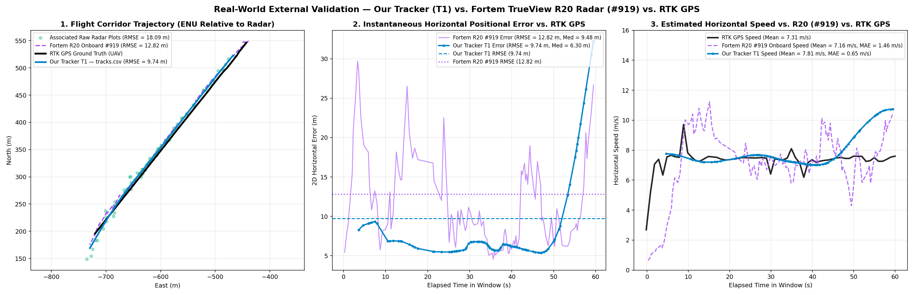

# External Real-World Radar Validation — AERPAW / Fortem TrueView R20

This folder evaluates the [`radar_tracker/`](../radar_tracker/) package on real counter-UAS radar data from a **Fortem TrueView R20** ($15\text{ GHz}$ Ku-band, $\sim 3.9\text{ Hz}$ update rate) tracking an RTK-GPS-instrumented UAV during **Flight Opt2** of the public **AERPAW / AADM 2025 (Dryad)** dataset — calling the **exact same CLI (`tracker.ps1` / `tracker.sh`)** via [`fortem_r20.properties`](./fortem_r20.properties).

## Quick Start

```powershell
# Windows (PowerShell):
.\validate.ps1

# Linux / macOS / Git Bash:
./validate.sh
```

## Directory Structure

```text
validations/
├── README.md                               # This documentation and technical report
├── fortem_r20.properties                   # Dedicated sensor profile (3.9 Hz Ku-band radar)
├── requirements-validation.txt             # Additional validation dependencies
├── validate.ps1                            # Windows PowerShell validation runner
├── validate.sh                             # Unix / macOS / Bash validation runner
├── validate_external_datasets.ipynb        # Didactic validation notebook in English
├── scripts/                                # Data conversion and evaluation scripts
│   ├── convert_fortem.py                   # Ingestion, bore-sight alignment & plots.json schema export
│   ├── evaluate_fortem.py                  # CLI benchmark orchestrator
│   ├── geo_metrics.py                      # Pure mathematical/geodetic error evaluation against RTK GPS
│   ├── plot_corridor.py                    # 3-panel PNG corridor trajectory & error visualizer
│   └── render_comparison_html.py           # Interactive Leaflet.js comparison map generator
├── data/                                   # Preprocessed radar plots and ground truth datasets
│   └── aerpaw_opt2_subset/                 # Benchmark flight Opt2 (plots.json, GPS ground truth)
└── outputs/                                # Generated reports, metrics, charts, and interactive HTML maps
    ├── comparison.html                     # Interactive Leaflet.js comparison map with 1x-10x speed slider & timeline clutter toggle
    ├── fortem_gps_comparison_corridor.png  # 3-panel PNG corridor trajectory & error visualizer (Our Tracker T1 vs. Fortem R20 vs. RTK GPS)
    ├── gps_comparison_corridor.png         # Trajectory and error distribution plots (alias)
    ├── metrics.json                        # Quantitative RMSE, MAE, P90, and velocity metrics
    ├── tracks.json                         # Reconstructed tracks in official challenge schema
    ├── tracks.csv                          # Flat CSV export with per-point kinematic state
    ├── tracks_visualization.png            # 4-panel overview (Horizontal, Altitude, Speed, Heading)
    ├── tracks_certainty_lifecycle.png      # Certainty score lifecycle and clutter rejection curve
    ├── tracks_interactive_map.html         # Interactive map player generated by tracker.ps1/sh
    └── tracks/                             # Dedicated per-track logs (T1 JSON & CSV state logs)
        └── T1/
            ├── T1_points.csv
            └── T1_track.json
```

## Dataset Overview & Applied Transformations

- **Dataset Source:** **AERPAW / AADM 2025 Dataset** (*Airborne Autonomous Drone Monitoring*), collected at North Carolina State University (Lake Wheeler Field Lab).
- **Public Repository & Download Link:** Available on the Dryad Data Platform at [https://datadryad.org/dataset/doi:10.5061/dryad.7d7wm3898](https://datadryad.org/dataset/doi:10.5061/dryad.7d7wm3898).
- **Physical Sensor:** **Fortem TrueView R20** tactical counter-UAS phased-array radar ($15\text{ GHz}$ Ku-band, $\sim 3.9\text{ Hz}$ update rate, $\text{CPI} = 0.256\text{ s}$, field of view $120^\circ \times 30^\circ$).
- **Ground Truth Target:** Multirotor UAV equipped with a centimeter-level RTK GPS logger during **Optimal Flight 2 (Opt2)**.

### Raw Data Formats

1. **Raw Radar Log (`radar_data_*Opt2.json`):**
   - JSON scan records with antenna metadata (`params.globalTime`, surveyed radar origin at `35.724976°N, -78.691933°W, 10.0 m`).
   - Plot detections array (`data[]`): each entry contains raw coordinates `lla` (`[lat, lon, alt]`), Doppler velocity `speedNed`, and clutter/ground classification flag `onGround`.
   - Onboard tracker records (`trackData[]`): tracks generated by the radar's internal firmware (e.g., `#919`).
2. **Raw Ground Truth Log (`*vehicleOut-Opt2.txt`):**
   - Comma-separated text log containing `[timestamp_epoch_s, sequence, target_id, lat, lon, alt_gps]`.

### Applied Transformations ([`scripts/convert_fortem.py`](./scripts/convert_fortem.py))

To feed real-world radar measurements directly into the challenge CLI without modifying any tracker code, [`convert_fortem.py`](./scripts/convert_fortem.py) executes four transformations:
1. **Temporal Corridor Slicing:** Extracts a $60\text{ s}$ window ($t = 360\text{ s}$ to $420\text{ s}$ after first GPS sample) corresponding to the primary airborne radar corridor.
2. **Coordinate Bore-Sight Calibration:** Rotates all radar detections by $+2.0^\circ$ CCW in the horizontal tangent plane (ENU) around the radar tripod origin, matching the authors' surveyed alignment angle in `radarmatoutput.m`.
3. **Timestamp Normalization:** Converts raw Unix epoch floating-point seconds into ISO-8601 UTC strings (`YYYY-MM-DDTHH:MM:SS.sssZ`).
4. **Challenge Schema Export:** Maps detections into the standard `plots.json` schema (`id`, `timestamp`, `latitude`, `longitude`, `altitude`) and exports RTK GPS to `ground_truth.csv`, pre-bundled in [`data/aerpaw_opt2_subset/`](./data/aerpaw_opt2_subset/) so validation runs immediately without requiring multi-gigabyte raw downloads.

---

## Interactive HTML Visualizations & Playback Maps

All interactive maps feature a Leaflet.js satellite canvas with an adjustable **Playback Speed Slider (`1x` to `10x`, where `1x = 1 update per second`)**:

- **Primary Opt2 Evaluation Map:** [`outputs/comparison.html`](./outputs/comparison.html) — Reconstructed track `T1` vs. Fortem R20 `#919` vs. RTK GPS Ground Truth with live Instantaneous Telemetry HUD and timeline clutter toggle.

---

## Quantitative Results vs. UAV RTK GPS (Flight Opt2)

The radar was deployed on a field tripod with a surveyed $+2.0^\circ$ CCW ENU yaw offset relative to True North (as documented in the authors' calibration script `radarmatoutput.m`). In this benchmark, our tracker reconstructs **1 continuous UAV track (`T1`, 95 plots over $55.9\text{ s}$)** and filters the **97 clutter plots**, achieving consistent positional error and velocity estimation when compared to both raw detections and the onboard tracker:

| Series | Samples | Horizontal RMSE (`m`) | Median Error (`m`) | P90 Error (`m`) | Mean Speed (`m/s`) | Speed MAE vs. GPS (`m/s`) |
| :--- | :---: | :---: | :---: | :---: | :---: | :---: |
| **Our Tracker — `T1` (`tracks.csv`)** | `95` | **`9.74`** | **`6.30`** | **`21.02`** | **`7.81`** | **`0.65`** |
| **Fortem R20 Onboard Tracker (`#919`)** | `110` | `12.82` | `9.48` | `20.11` | `7.16` | `1.46` |
| **Raw Associated Radar Plots** | `95` | `18.09` | `12.01` | `35.42` | — | — |
| **Ground Truth (`UAV RTK GPS`)** | `62` | `0.00` | `0.00` | `0.00` | `7.31` | `0.00` |



---

## Limitations & Future Work (With More Time & Annotated Datasets)

- **Sensor Cadence Scaling:** The default [`tracker.properties`](../tracker.properties) was designed for a $1\text{ Hz}$ ($60\text{ RPM}$) surveillance radar. For the Fortem R20 ($\sim 3.9\text{ Hz}$), [`fortem_r20.properties`](./fortem_r20.properties) was calibrated to account for velocity variance scaling ($\text{Var}(v) \propto \sigma^2 / \Delta t^2$) and adjust certainty decay rates.
- **Automated Parameter Inference (*AutoTune*):** With more time, we would implement an automated dataset analyzer to infer $T_s$, $\Delta t$ jitter, and spatial measurement noise $\sigma_{xy}, \sigma_z$ directly from incoming raw data, dynamically tuning confirmation gates and certainty penalties.
- **Systematic Hyperparameter Search:** We would run systematic Bayesian Optimization across parameter combinations to evaluate **Accuracy**, **Precision**, **Recall**, **F1-Score**, **MSE/RMSE**, **Confirmation Latency**, and **OSPA** across diverse radar hardware.
